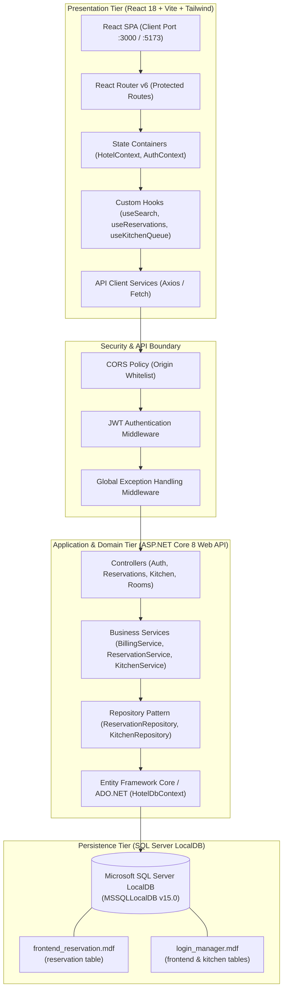

# 02 - System Architecture Document

## 1. High-Level Architectural Overview
The Grand Horizon Palace Hotel Management System is built upon a modern **Decoupled Client-Server Architecture** adhering to clean architecture principles:
* **Presentation Tier**: Single Page Application (SPA) built with React 18, TypeScript, and Tailwind CSS, bundled with Vite.
* **API & Domain Tier**: ASP.NET Core 8 Web API utilizing dependency injection, repository pattern, and service abstractions.
* **Data Tier**: Microsoft SQL Server LocalDB (`(LocalDB)\MSSQLLocalDB`) providing relational storage, ACID transactions, and indexing.

---

## 2. Technology Stack Justification

| Technology | Selection Rationale |
| :--- | :--- |
| **React 18 + TypeScript** | React 18 concurrent rendering and automatic batching ensure non-blocking UI during high-frequency data filtering. TypeScript provides compile-time type safety across DTOs and view models. |
| **Tailwind CSS 3.4** | Utility-first CSS framework enabling zero-runtime overhead, strict design token consistency, and effortless responsive breakpoints without stylesheet bloat. |
| **Vite 5** | Instant hot module replacement (HMR), lightning-fast ES module dev server, and optimized Rollup production builds (<2s re-compiles). |
| **ASP.NET Core 8 Web API** | Top-tier throughput, cross-platform execution, native dependency injection, built-in asynchronous I/O (`async/await`), and strong enterprise support. |
| **SQL Server LocalDB** | Zero-configuration embedded developer engine with 100% T-SQL compatibility with enterprise SQL Server, perfect for low-cost, on-premise, and offline installations. |

---

## 3. Security Boundaries & Token Pipeline

1. **Authentication Boundary**:
   - Client sends credentials (`username`, `password`) over HTTPS POST to `/api/auth/login`.
   - API verifies password hash using PBKDF2 with HMAC-SHA256.
   - API returns JWT token containing standard claims: `sub`, `unique_name`, `role`, `exp` (15 minutes).
2. **Authorization Boundary**:
   - `JwtMiddleware` inspects incoming `Authorization: Bearer <token>` header.
   - ASP.NET Core `[Authorize(Roles = "Admin,Manager")]` attributes guard sensitive controller actions.
   - Client `ProtectedRoute.tsx` prevents unauthorized view rendering in the browser.
3. **Data Protection**:
   - Parameterized SQL prevents T-SQL injection attacks.
   - Cross-Origin Resource Sharing (CORS) locked to approved client origins (`http://localhost:3000`, `http://localhost:5173`).

---

## 4. Deployment Topologies

### Local Development Topology
* **Database**: `(LocalDB)\MSSQLLocalDB` hosting attached `.mdf` files.
* **Server**: ASP.NET Core Kestrel HTTP Server on `https://localhost:5001` / `http://localhost:5000`.
* **Client**: Vite Development Server with HMR on `http://localhost:5173` (or `:3000`).

### Production Container Topology
* **docker-compose.yml** orchestrating three isolated containers:
  * `hotel-client`: Multi-stage build with Nginx reverse proxy serving static React SPA on port 3000.
  * `hotel-server`: ASP.NET Core 8 runtime image running Kestrel on port 5000.
  * `hotel-db`: Microsoft SQL Server Linux container (`mcr.microsoft.com/mssql/server:2022-latest`) on port 1433 with mounted volume.
