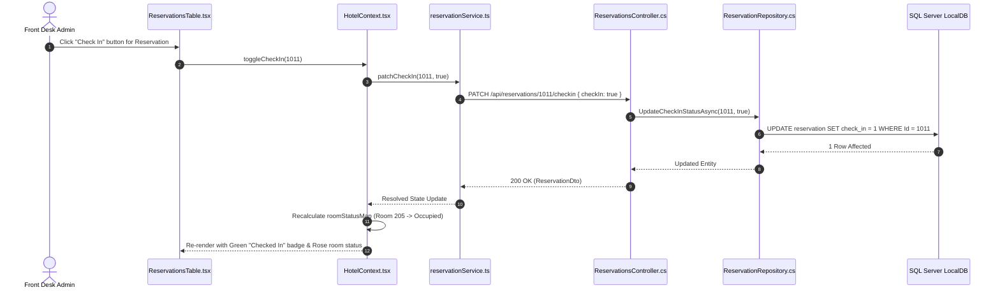
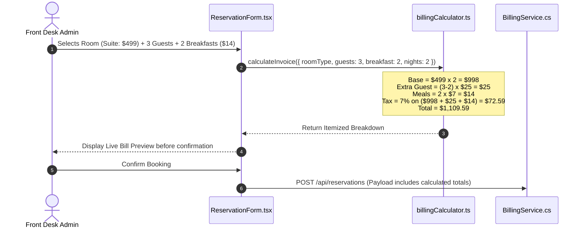
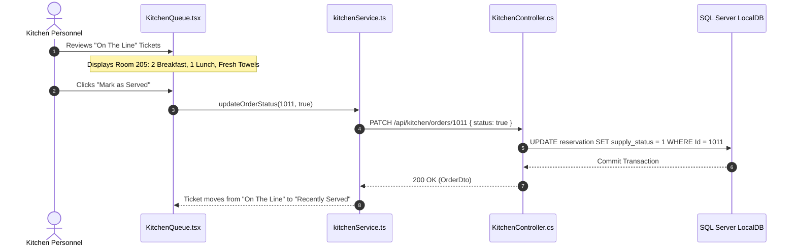

# 03 - System Design Document

## 1. Sequence Diagrams of Core Operational Workflows

### 1.1 Guest Check-In & State Transition Flow


### 1.2 Deterministic Billing & Tax Calculation Flow


### 1.3 Kitchen Dining Order Fulfillment Flow


---

## 2. State Management Architecture

### `AuthContext.tsx`
* **Responsibilities**: Holds active user session, decoded JWT claims, role classification (`Admin`, `Kitchen`, `Manager`), and expiration timer.
* **Storage Sync**: Persists token in secure `sessionStorage` with automated silent refresh / logout trigger on token expiry.

### `HotelContext.tsx`
* **Responsibilities**:
  * **`reservations`**: Master list of active and historic bookings.
  * **`roomStatusMap`**: Memoized hashmap keyed by Room Number (`101` through `510`) deriving room state (`Available`, `Reserved`, `Occupied`) with $O(1)$ lookup performance.
  * **`stats`**: Live aggregated metrics (Gross Revenue, Active Occupants, Pending Queue Tickets, Occupancy Percentage).
* **Concurrency Handling**: Employs optimistic UI updates with automatic rollback if the background API call rejects.

---

## 3. Global Exception & Error Handling Strategy

### Client-Side Error Boundary & Interceptor
* **React `ErrorBoundary`**: Wraps the route hierarchy to catch runtime UI rendering exceptions, presenting an executive error card with "Reload Session" action.
* **Axios Response Interceptor**: Intercepts HTTP 401 Unauthorized (triggers clean logout and redirects to `/login`), HTTP 403 Forbidden (renders permission alert), and HTTP 500 (surfaces localized toast error without application crash).

### Server-Side `ExceptionHandlingMiddleware.cs`
* Centralized ASP.NET Core middleware wrapping the HTTP pipeline in a `try-catch` block:
```csharp
public async Task InvokeAsync(HttpContext context, RequestDelegate next)
{
    try
    {
        await next(context);
    }
    catch (Exception ex)
    {
        _logger.LogError(ex, "Unhandled exception occurred. TraceId: {TraceId}", context.TraceIdentifier);
        context.Response.ContentType = "application/json";
        context.Response.StatusCode = (int)HttpStatusCode.InternalServerError;
        var errorResponse = new ErrorResponseDto
        {
            Error = "An unexpected error occurred. Please contact front desk support.",
            Code = "INTERNAL_SERVER_ERROR",
            TraceId = context.TraceIdentifier,
            Timestamp = DateTime.UtcNow
        };
        await context.Response.WriteAsJsonAsync(errorResponse);
    }
}
```

---

## 4. Performance & Caching Strategy

1. **Universal Search Debounce**: Input search queries are debounced at **300ms** to prevent intermediate filter thrashing while preserving perception of immediate responsiveness.
2. **Client-Side Indexing**: Reservations list is indexed in memory with pre-computed lowercase search tokens for substring scanning, ensuring search filter times consistently stay **below 50ms**.
3. **Room Matrix Memoization**: `useMemo` recomputes the 50-room occupancy matrix only when the `reservations` reference identity changes.
