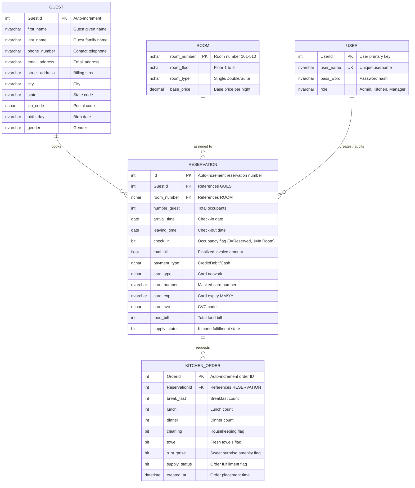

# 04 - Database Design & Schema Specification

## 1. Relational Entity-Relationship Diagram



---

## 2. Complete Data Dictionary (`frontend_reservation.mdf`)

The physical table `reservation` incorporates all 33 legacy and operational columns maintaining binary compatibility with SQL Server LocalDB:

| # | Column Name | Physical Data Type | Nullable | Primary / Foreign Key | Description & Integrity Constraints |
| :---: | :--- | :--- | :---: | :---: | :--- |
| 1 | `Id` | `int IDENTITY(1001,1)` | NO | **PK** | Unique reservation tracking number. |
| 2 | `first_name` | `nvarchar(50)` | NO | - | Guest legal first name (1-50 chars). |
| 3 | `last_name` | `nvarchar(50)` | NO | - | Guest legal last name (1-50 chars). |
| 4 | `birth_day` | `nvarchar(50)` | NO | - | Date of birth string in `YYYY-MM-DD` ISO format. |
| 5 | `gender` | `nvarchar(50)` | NO | - | Gender classification (`Male`, `Female`, `Other`). |
| 6 | `phone_number` | `nvarchar(50)` | NO | - | Primary phone number formatted as `(###) ###-####`. |
| 7 | `email_address` | `nvarchar(MAX)` | NO | - | Validated email address for receipt distribution. |
| 8 | `number_guest` | `int` | NO | - | Total occupant headcount (Domain: 1 to 6). |
| 9 | `street_address` | `nvarchar(MAX)` | NO | - | Primary street delivery & billing address line. |
| 10 | `apt_suite` | `nvarchar(50)` | NO | - | Optional secondary unit or apartment number. |
| 11 | `city` | `nvarchar(MAX)` | NO | - | Municipality / City name. |
| 12 | `state` | `nvarchar(50)` | NO | - | Two-letter standard US state abbreviation. |
| 13 | `zip_code` | `nchar(10)` | NO | - | Postal / ZIP code. |
| 14 | `room_type` | `nchar(10)` | NO | - | Category: `Single`, `Double`, `Twin`, `Duplex`, `Suite`. |
| 15 | `room_floor` | `nchar(10)` | NO | - | Structural floor tier: `1`, `2`, `3`, `4`, `5`. |
| 16 | `room_number` | `nchar(10)` | NO | - | Assigned room designation (`101` to `510`). |
| 17 | `total_bill` | `float` | NO | - | Invoiced grand total including taxes and dining. |
| 18 | `payment_type` | `nchar(10)` | NO | - | Payment tender: `Credit Card`, `Debit Card`, `Cash`. |
| 19 | `card_type` | `nchar(10)` | NO | - | Card issuer: `Visa`, `MasterCard`, `Amex`, `Discover`. |
| 20 | `card_number` | `nvarchar(50)` | NO | - | Primary account number (masked for PCI compliance). |
| 21 | `card_exp` | `nvarchar(50)` | NO | - | Card expiration date string (`MM/YY`). |
| 22 | `card_cvc` | `nchar(10)` | NO | - | Card security verification digits. |
| 23 | `arrival_time` | `date` | NO | - | Scheduled check-in arrival date (`YYYY-MM-DD`). |
| 24 | `leaving_time` | `date` | NO | - | Scheduled check-out departure date (`YYYY-MM-DD`). |
| 25 | `check_in` | `bit` | NO | - | `0` = Reserved / Pending; `1` = Currently In-House. |
| 26 | `break_fast` | `int` | NO | - | Quantity of breakfast meal portions ($7 each). |
| 27 | `lunch` | `int` | NO | - | Quantity of lunch meal portions ($12 each). |
| 28 | `dinner` | `int` | NO | - | Quantity of dinner meal portions ($15 each). |
| 29 | `cleaning` | `bit` | NO | - | Daily housekeeping request flag (`1` = Yes, `0` = No). |
| 30 | `towel` | `bit` | NO | - | Fresh towel replenishment flag (`1` = Yes, `0` = No). |
| 31 | `s_surprise` | `bit` | NO | - | VIP sweet surprise gift amenity (`1` = Yes, `0` = No). |
| 32 | `supply_status` | `bit` | NO | - | Kitchen fulfillment indicator (`1` = Served, `0` = Pending). |
| 33 | `food_bill` | `int` | NO | - | Cumulative pre-tax dining and meal charge subtotal. |

---

## 3. High-Performance Indexing Strategy

To guarantee sub-50ms search query performance across large datasets, the database specifies targeted B-Tree indexes:

```sql
-- 1. Composite Covering Index for Guest Lookups & Universal Search
CREATE NONCLUSTERED INDEX IX_reservation_guest_search
ON reservation (last_name, first_name, room_number)
INCLUDE (phone_number, email_address, check_in, total_bill);

-- 2. Index for Occupancy & Status Filtering
CREATE NONCLUSTERED INDEX IX_reservation_status
ON reservation (check_in, arrival_time, leaving_time)
INCLUDE (room_number, room_type);

-- 3. Filtered Index for Kitchen FIFO Active Queue
CREATE NONCLUSTERED INDEX IX_reservation_kitchen_queue
ON reservation (supply_status, Id)
WHERE (break_fast > 0 OR lunch > 0 OR dinner > 0 OR cleaning = 1 OR towel = 1 OR s_surprise = 1);
```

---

## 4. Connection String & Script Location

* **SQL Script Location**: `/infra/database/attach-database.sql`
* **LocalDB ADO.NET Connection String**:
```text
Data Source=(LocalDB)\MSSQLLocalDB;AttachDbFilename=|DataDirectory|\frontend_reservation.mdf;Integrated Security=True;Connect Timeout=30
```
* **Production Connection String (Docker Container)**:
```text
Server=hotel-db,1433;Database=frontend_reservation;User Id=sa;Password=YourStrong@Password123;TrustServerCertificate=True;
```
